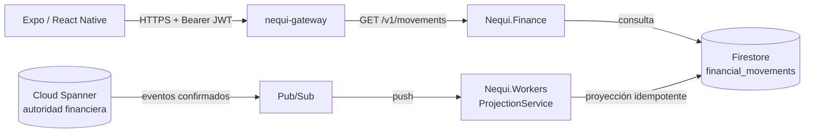
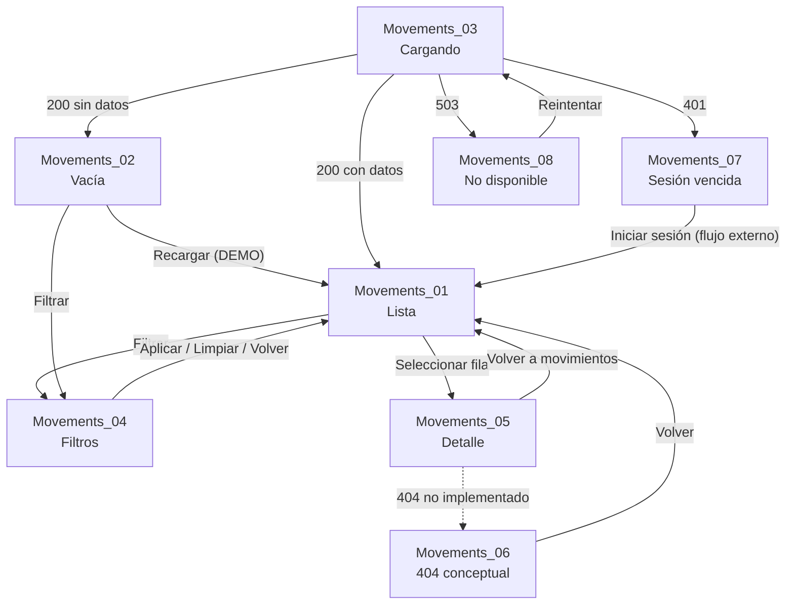

# UX Mapping — Módulo Movimientos

**Módulo:** Movimientos (`Movements_01`–`Movements_08`)  
**Fuente UX:** `frontend/NequiTrampa_UX_Mapping_Completo.pdf`, casos 234–241  
**Fuente visual:** `frontend/DESIGN.md`  
**Backend de referencia:** `src/Nequi.Finance`, `src/Nequi.Gateway`, `src/Nequi.Workers`  
**Rama:** `Nicolas-frontend/integracion`  
**Estado:** documentación de contrato; no implica integración implementada

> Este documento mapea el UX documentado contra contratos verificados en el código. No autoriza modificaciones al backend, no crea contratos nuevos y no convierte datos DEMO en operaciones reales.

---

## 1. Resumen y alcance

- El PDF documenta **8 casos** del módulo Movimientos, páginas **234–241**.
- Los 8 casos indican `GET /v1/movements` en su bloque de endpoint, incluidos los estados 404, 401 y 503.
- El backend implementa **solo** `GET /v1/movements` como listado de movimientos.
- No existe endpoint de detalle, búsqueda, filtros del servidor ni paginación por cursor.
- El listado devuelve un máximo de **200** elementos por solicitud; no hay forma de recuperar elementos anteriores al límite.
- Los filtros de `Movements_04` solo pueden aplicarse en el cliente sobre los elementos ya cargados.
- La pantalla de detalle no puede obtener una referencia de negocio ni el nombre de la contraparte desde `MovementDto`.
- La pantalla 404 no tiene un endpoint que la origine: una lista vacía responde `200`, no `404`.
- La pantalla 503 no tiene una ruta explícita en Finance; puede representar una indisponibilidad de infraestructura.
- El frontend actual usa datos DEMO y `MovementsState`; todavía no consume la API.
- El backend actual es `src/Nequi.*` (incluido en `Nequi.slnx`). `src/backend/wallet-api/` no está en la solución y no debe usarse como referencia.

### Clasificación usada

| Clasificación | Significado |
|---|---|
| `VERIFIED` | Comportamiento o contrato verificado en el backend o en pruebas existentes. |
| `DOCUMENTED_ONLY` | El UX lo documenta, pero no existe una ruta o contrato backend verificado. |
| `CONFLICT` | El UX y el backend no coinciden, o el UX asume datos que el contrato no entrega. |
| `NOT_APPLICABLE` | No aplica para este módulo de solo lectura. |

---

## 2. Arquitectura y flujo de datos



- URL pública documentada: `https://nequi-gateway-7v3gdoy4ra-tl.a.run.app`.
- El gateway enruta `GET /v1/movements` al servicio `finance` (`src/Nequi.Gateway/Program.cs:41`).
- La autenticación es JWT de Google Cloud Identity Platform enviado como `Authorization: Bearer <JWT>`.
- Firestore es un **read model**; no es la autoridad financiera. La autoridad es Spanner.
- La proyección es eventualmente consistente: una operación recién confirmada puede no aparecer inmediatamente en el historial.
- `GET /v1/projections/movements` existe en Workers, pero no es la ruta pública del frontend. Usar únicamente `GET /v1/movements` a través del gateway.

---

## 3. Contrato API verificado

### 3.1 Endpoint

```http
GET /v1/movements
Authorization: Bearer <JWT>
```

| Parámetro | Ubicación | Obligatorio | Regla |
|---|---|---|---|
| `limit` | query | No | Entero entre `1` y `200`; por defecto `50`. |
| `clientId` | query | Solo staff | `CLIENTE` usa el `client_id` de su token; no puede cambiarlo por query. `SOPORTE` y `OPERADOR_FINANCIERO` deben indicarlo. `ADMIN` recibe `403`. |

- No se aceptan filtros por fecha, tipo, monto, texto ni cursor.
- El orden es descendente por `occurredAt`.
- El endpoint no escribe datos; es de solo lectura.

### 3.2 Respuesta exitosa

Ejemplo ilustrativo; los UUID y valores no son datos reales:

```json
{
  "clientId": "00000000-0000-0000-0000-000000000001",
  "count": 1,
  "limit": 50,
  "items": [
    {
      "eventId": "00000000-0000-0000-0000-000000000002",
      "operationId": "00000000-0000-0000-0000-000000000003",
      "type": "RECHARGE_COMPLETED",
      "amountCents": 30000000,
      "currency": "COP",
      "counterpartyClientId": null,
      "description": "Recarga simulada vía Tarjeta",
      "balanceAfterCents": 125000000,
      "occurredAt": "2026-10-08T14:02:00.0000000Z",
      "syncStatus": "SYNCED",
      "status": "COMPLETED"
    }
  ]
}
```

| Campo | Tipo | Nulo | Uso en UI |
|---|---|---|---|
| `clientId` | string | No | Propietario del listado; no visible. |
| `count` | number | No | Cantidad de elementos de **esta página**, no el total histórico. |
| `limit` | number | No | Límite aplicado a la página. |
| `items` | array | No | Filas del historial. |
| `eventId` | string | Sí | Clave única de la fila; no mostrar como referencia de negocio. |
| `operationId` | string | Sí | UUID interno; no es `REC-...` ni `TRF-...`. |
| `type` | string | Sí | Categoría del evento. |
| `amountCents` | number (int64) | No | Monto en centavos, con signo. |
| `currency` | string | Sí | Validar `COP`. |
| `counterpartyClientId` | string | Sí | UUID de contraparte; no contiene nombre ni teléfono. |
| `description` | string | Sí | Descripción libre o generada; puede faltar en transferencias. |
| `balanceAfterCents` | number (int64) | Sí | Saldo después del movimiento; no siempre disponible. |
| `occurredAt` | string ISO 8601 UTC | Sí | Fecha/hora del movimiento. |
| `syncStatus` | string | Sí | Estado de proyección; no mostrar como estado financiero. |
| `status` | string | Sí | Estado del evento; la proyección usa `COMPLETED`. |

### 3.3 Semántica de importes y tipos

- `amountCents` es un entero de centavos, nunca un `float`.
- `amountCents` es un delta con signo para el cliente:
  - Negativo: salida/débito.
  - Positivo: entrada/crédito.
- Tipos confirmados en el dominio:
  - `TRANSFER_COMPLETED`
  - `RECHARGE_COMPLETED`
  - `REVERSAL_COMPLETED`
  - `ADMIN_ADJUSTMENT`
- La proyección de movimientos entrega actualmente `TRANSFER_COMPLETED` y `RECHARGE_COMPLETED`.
- `TRANSFER_COMPLETED` no distingue enviado/recibido por sí solo; la dirección se deriva del signo de `amountCents`.
- `status` y `syncStatus` no sustituyen la consulta de saldo ni la confirmación de una operación.

### 3.4 Errores

Los errores usan `application/problem+json` (RFC 9457), con:

```json
{
  "type": "https://httpstatuses.com/400",
  "title": "Bad Request",
  "status": 400,
  "detail": "Staff must provide ?clientId= to query movements.",
  "instance": "/v1/movements",
  "code": "clientid_required",
  "requestId": "..."
}
```

| HTTP | `code` | Cuándo ocurre | Pantalla |
|---|---|---|---|
| `200` | — | Lista con datos o vacía. | `Movements_01` / `Movements_02` |
| `400` | `missing_client_id` | Token `CLIENTE` sin claim `client_id`. | No definida |
| `400` | `clientid_required` | Staff sin `?clientId=`. | No definida |
| `400` | `invalid_limit` | `limit < 1` o `limit > 200`. | No definida |
| `401` | `unauthenticated` | Token ausente, inválido o expirado. | `Movements_07` |
| `403` | `forbidden` | Rol sin acceso (por ejemplo `ADMIN`) o acceso no permitido. | No definida |
| `500` | `internal_error` | Excepción no controlada. | No definida |
| `503` | — | Indisponibilidad de infraestructura; no hay emisión explícita en Finance. | `Movements_08` (documentada) |

- `requestId` sirve para soporte; no debe mostrarse como dato principal ni registrarse junto a datos financieros sensibles.
- Un `CLIENTE` que intente consultar otro `clientId` no obtiene `403`: el backend ignora el query y usa el propietario del token.
- `ADMIN` no usa este endpoint; recibe `403` y debe ir a backoffice.

### 3.5 Referencia de negocio y contraparte

El PDF muestra `REC-000071` en el detalle. El backend **no entrega** ese dato:

- `operationId` es un UUID interno.
- No existe `publicReference`, `reference`, `transactionCode` ni equivalente en `MovementDto`.
- No existe un endpoint de detalle que traduzca `operationId` a una referencia.
- `counterpartyClientId` es un UUID opaco; no incluye nombre, alias ni teléfono.
- `description` es opcional y no garantiza un nombre de contraparte.

**Conclusión:** la referencia `REC-...` y el nombre de la contraparte del diseño no pueden reproducirse de forma fiel con el contrato actual. No inventar una referencia a partir de `eventId`/`operationId` ni mostrar el UUID como si fuera la referencia del producto.

---

## 4. Pantallas, endpoints y clasificación

| Caso / página | Pantalla | Stitch ID | Archivo actual | Estado UX | Endpoint PDF | Respuesta esperada | Acción / navegación | Clasificación |
|---|---|---|---|---|---|---|---|---|
| 234 | `Movements_01` · Lista | `17280cab7e8e45b8af5e10855af4ca24` | `src/screens/movements/Movements01Screen.tsx` | Historial | `GET /v1/movements` | `200` con `items` | Filtrar → 04; seleccionar → 05 | `VERIFIED` |
| 235 | `Movements_02` · Lista vacía | `d3d292fb68484f329446d5e391c1bfe7` | `Movements02Screen.tsx` | Sin movimientos | `GET /v1/movements` | `200` con `count: 0` | Filtrar → 04; recargar → 01 (DEMO) | `VERIFIED` |
| 236 | `Movements_03` · Cargando | `306834af5b9c431290b15a4176c2dd1a` | `Movements03Screen.tsx` | Carga inicial | `GET /v1/movements` | `200` esperado | Evitar acciones duplicadas | `VERIFIED` como estado de UI |
| 237 | `Movements_04` · Filtros | `a12078ae5be64ed28275067e429709bd` | `Movements04Screen.tsx` | Filtros | `GET /v1/movements` | No hay filtros de servidor | Aplicar / limpiar → 01 | `CONFLICT` |
| 238 | `Movements_05` · Detalle | `6d7c1efabf7d4369a89a8a813e4d3c4d` | `Movements05Screen.tsx` | Detalle | `GET /v1/movements` | No hay endpoint de detalle | Volver → 01 | `CONFLICT` |
| 239 | `Movements_06` · Detalle no encontrado | `835483dcd08c425b9fb897d6e024d9c5` | `Movements06Screen.tsx` | 404 | `GET /v1/movements` | No se emite `404` en lista | Volver → 01 | `CONFLICT` / `DOCUMENTED_ONLY` |
| 240 | `Movements_07` · 401 Sesión vencida | `9de89c036aa14283b961e7b5e7bf35f3` | `Movements07Screen.tsx` | 401 | `GET /v1/movements` | `401` verificado | Iniciar sesión (flujo externo) | `VERIFIED` para el error |
| 241 | `Movements_08` · 503 No disponible | `45575e72317e4ed9992fb4c3b4db7a3c` | `Movements08Screen.tsx` | 503 | `GET /v1/movements` | Sin ruta Finance explícita | Reintentar → 01 | `DOCUMENTED_ONLY` |

### Observaciones por pantalla

- **01 Lista:** el PDF usa filtros `Todos / Enviados / Recibidos / Recargas`; el backend no recibe filtros. La lista actual filtra DEMO en memoria.
- **02 Vacía:** la copia “Sin movimientos todavía…” corresponde a `count = 0`. No es un `404` ni un `204`.
- **03 Cargando:** no existe un endpoint de skeleton; es un estado local mientras la única petición está en curso.
- **04 Filtros:** el PDF muestra `Desde`, `Hasta` y `Monto mínimo`; no existen parámetros backend para esos campos.
- **05 Detalle:** el PDF reutiliza `GET /v1/movements`; no hay `GET /v1/movements/{id}`. El detalle actual recibe un `MovementItem` DEMO desde la lista.
- **06 404:** el PDF asume un detalle que puede responder `404`. Con el contrato actual, seleccionar una fila siempre parte de un elemento ya cargado; no hay una consulta que produzca ese 404.
- **07 401:** el error HTTP está verificado, pero no existe un módulo de login mapeado en Movimientos.
- **08 503:** el PDF lo documenta, pero Finance no tiene una ruta que lo emita. Puede venir de gateway/Cloud Run u otra capa.

---

## 5. Navegación

La navegación actual es por estado local en `frontend/App.tsx:19`; no hay React Navigation ni Expo Router.



| Acción | Estado actual | Destino | Contrato |
|---|---|---|---|
| Filtrar | `onOpenFilter` | `Movements_04` | No hay filtros de servidor. |
| Aplicar filtros | `onApplyFilters` | `Movements_01` | Filtrado local sobre la página cargada. |
| Seleccionar movimiento | `handleSelectMovement` | `Movements_05` | Usa el elemento en memoria; no consulta detalle. |
| Volver | `onBack` | `Movements_01` | No hay recarga automática. |
| Recargar | `onRechargePress` | `Movements_01` (DEMO) | La recarga pertenece a otro módulo; no se define aquí. |
| Iniciar sesión | `onLoginPress` | `Movements_01` (DEMO) | Debe sustituirse por el flujo de autenticación real. |
| Reintentar | `onRetryPress` | `Movements_01` (DEMO) | Debe repetir la carga, no crear una operación. |

- `DevStateBar` es un selector de previsualización, no navegación de producto.
- La barra inferior `Inicio / Movimientos / Asistente / Perfil` no tiene rutas ni endpoints mapeados en este documento.
- En integración real, `Movements_07` no debe volver directamente a la lista sin renovar la sesión.

---

## 6. Estados de interfaz y manejo de errores

| Situación | Pantalla | Regla |
|---|---|---|
| Petición inicial | `Movements_03` | Mostrar skeleton; una sola petición en curso. |
| `200` con `count > 0` | `Movements_01` | Renderizar `items` en el orden recibido. |
| `200` con `count = 0` | `Movements_02` | Estado vacío global; no usar copia de “sin resultados”. |
| Filtro local sin coincidencias | Pendiente | No reutilizar automáticamente la copia de “Sin movimientos todavía”; el usuario sí tiene historial. |
| `401` | `Movements_07` | Sesión inválida/expirada; no reintentar la misma petición sin autenticar. |
| `403` | Pendiente | No mostrar como “sesión vencida”; es un problema de permisos. |
| `400` | Pendiente | Error de integración/token/parámetros; no reintentar en bucle. |
| `404` | `Movements_06` | Solo conceptual para detalle; el listado no devuelve 404. |
| `500` | Pendiente | No hay pantalla específica; no etiquetar como 503 sin decisión de producto. |
| `503` | `Movements_08` | Ofrecer reintento; conservar el estado y no duplicar solicitudes. |
| Error de red | Pendiente | No equivale a 503; definir copy y reintento. |
| Proyección aún no actualizada | Pendiente | No hay endpoint de estado; la copia del 404 menciona “actualizándose”, pero no hay polling definido. |

Reglas transversales:

- `GET` es idempotente; el reintento no crea movimientos.
- Evitar solicitudes concurrentes duplicadas durante carga/reintento.
- No mostrar `requestId`, JWT ni UUID internos como datos de negocio.
- No mostrar una operación como confirmada si solo existe un estado DEMO o una respuesta incompleta.
- Un `200` vacío es un resultado válido, no un error.
- La ausencia temporal de una operación recién creada puede ser consistencia eventual; no convertirla automáticamente en una operación fallida.

---

## 7. Autenticación y permisos

| Tema | Contrato |
|---|---|
| Token | JWT de Identity Platform en `Authorization: Bearer <JWT>`. |
| Issuer | `https://securetoken.google.com/{projectId}`. |
| Audience | `projectId`. |
| Rol `CLIENTE` | Solo sus propios movimientos, usando el claim `client_id`. |
| Rol `SOPORTE` | Puede consultar un `clientId` explícito. |
| Rol `OPERADOR_FINANCIERO` | Puede consultar un `clientId` explícito. |
| Rol `ADMIN` | `403` en este endpoint; usar backoffice. |
| Token sin `client_id` | `400 missing_client_id`, no `401`. |
| Token ausente/inválido | `401 unauthenticated`. |

- El frontend actual no tiene Firebase/Auth instalado; no se debe simular autenticación con datos DEMO.
- `EXPO_PUBLIC_API_URL` solo debe contener la URL pública del gateway; nunca secretos, claves privadas ni JWT.
- No registrar tokens completos, `clientId`, montos ni otra información financiera sensible en logs.

---

## 8. Mapeo `MovementDto` → componentes

| Dato backend | Componente actual | Transformación |
|---|---|---|
| `eventId` | clave de lista | `keyExtractor`; no visible. |
| `operationId` | — | UUID interno; no usar como `reference` visible. |
| `type` + signo de `amountCents` | `title` / `categoryLabel` / filtro | Derivar “Transferencia enviada”, “Transferencia recibida” o “Recarga”. |
| `amountCents` | importe | `amount = amountCents / 100`; formatear COP; conservar signo. |
| `currency` | — | Validar `COP`; no convertir moneda. |
| `counterpartyClientId` | — | UUID opaco; no hay nombre para mostrar. |
| `description` | título/subtítulo | Usar si existe; si no, fallback genérico por tipo. |
| `balanceAfterCents` | “Saldo después” | Mostrar solo si no es `null`. |
| `occurredAt` | “Fecha” | Parsear ISO UTC; mostrar en `es-CO`, zona `America/Bogota`. |
| `status` | “Completada” | `COMPLETED` → “Completada”; no inferir estados no entregados. |
| `syncStatus` | — | Dato interno de proyección; no mostrar. |
| `count` | paginación/estado | Es la cantidad de la página, no el total histórico. |
| `limit` | paginación | Límite aplicado; máximo 200. |

### Reglas de derivación propuestas

| Condición | Tipo UI | Filtro |
|---|---|---|
| `type = TRANSFER_COMPLETED` y `amountCents < 0` | Transferencia enviada | `ENVIADOS` |
| `type = TRANSFER_COMPLETED` y `amountCents > 0` | Transferencia recibida | `RECIBIDOS` |
| `type = RECHARGE_COMPLETED` | Recarga | `RECARGAS` |
| Otro tipo | Movimiento / Pendiente de categoría | Solo `TODOS` |

Estas etiquetas son una adaptación de UI a los datos reales. La referencia y el nombre de contraparte del diseño no forman parte de este mapeo porque el backend no los entrega.

---

## 9. Filtros

El PDF de `Movements_04` muestra:

- Tipo: `Todos`, `Enviados`, `Recibidos`, `Recargas`.
- `Desde`: `1 oct 2026`.
- `Hasta`: `8 oct 2026`.
- `Monto mínimo`: `$0`.
- Acciones: `Aplicar filtros`, `Limpiar`.

Contrato real:

- `GET /v1/movements` solo acepta `limit` y, para staff, `clientId`.
- No hay parámetros `from`, `to`, `type`, `minAmountCents`, `cursor` ni `offset`.
- Por tanto, los filtros deben aplicarse localmente sobre los elementos ya cargados.
- El filtrado local es incompleto si el historial supera el máximo de 200 elementos, porque no hay paginación.
- El filtro por fecha debe interpretar los límites en la zona horaria de presentación (`America/Bogota`) y definir si `Hasta` es inclusivo.
- El filtro por monto debe comparar `amountCents` con el monto ingresado convertido a centavos; no usar comparaciones de punto flotante.

**Cambio de contrato requerido si se desea filtrado completo:** agregar parámetros de fecha, tipo, monto y paginación al endpoint, con total real y cursor estable. No implementar ese cambio sin autorización de backend.

---

## 10. Discrepancias y deuda de contrato

| Tema | UX / PDF | Backend actual | Impacto | Clasificación | Acción |
|---|---|---|---|---|---|
| Detalle | `GET /v1/movements`, pantalla de detalle | No hay `GET /v1/movements/{id}` | El detalle solo puede reutilizar una fila en memoria. | `CONFLICT` | Mantener selección desde lista; solicitar contrato de detalle. |
| Referencia | `REC-000071` | Solo `eventId` y `operationId` UUID | No se puede mostrar la referencia del diseño. | `CONFLICT` | Ocultar fila o esperar `publicReference`. |
| Contraparte | “Transferencia a Laura” | `counterpartyClientId` UUID, sin nombre | No se puede mostrar el nombre. | `CONFLICT` | Usar descripción genérica; no inventar nombre. |
| 404 | Pantalla de detalle no encontrado | No hay ruta que emita 404 | La pantalla no tiene un disparador real. | `CONFLICT` | Mantener como preview; no simular en producción. |
| 503 | Pantalla de servicio no disponible | Sin emisión explícita en Finance | El estado puede existir solo en gateway/infra. | `DOCUMENTED_ONLY` | Tratar como indisponibilidad genérica; definir contrato si se requiere. |
| Filtros | Tipo, fechas y monto | Solo `limit` | Filtrado local y potencialmente incompleto. | `CONFLICT` | Implementar localmente o ampliar backend. |
| Paginación | Historial completo | Sin offset/cursor; máximo 200 | No hay acceso a historial anterior. | `CONFLICT` | Definir paginación antes de prometer historial completo. |
| `count` | Posible total | `count = items.Count` de la página | No sirve como total histórico. | `CONFLICT` | No mostrar `count` como total. |
| Estados pendientes/fallidos | El tipo DEMO admite `Pendiente`/`Fallida` | La proyección solo materializa eventos completados | Operaciones no confirmadas no aparecen como pendientes. | `CONFLICT` | No prometer estados no entregados. |
| Tipo de transferencia | Enviado/Recibido | `TRANSFER_COMPLETED` + signo | Requiere derivación local. | `VERIFIED` con transformación | Implementar derivación por signo. |
| Lista vacía | “Sin movimientos” | `200 count = 0` | Correcto; no es 404. | `VERIFIED` | Usar `Movements_02`. |
| Token sin contexto | Pantalla 401 | `400 missing_client_id` | Un problema de token puede caer en un estado sin pantalla. | `CONFLICT` | Definir manejo de 400/auth. |
| Staff sin cliente | No documentado | `400 clientid_required` | Aplica a herramientas internas, no al cliente. | `VERIFIED` | Documentar para soporte/backoffice. |
| Admin | No documentado | `403` | No usar este endpoint para Admin. | `VERIFIED` | Redirigir a backoffice si aplica. |
| Consistencia | Historial inmediato | Proyección eventual | Una operación reciente puede no aparecer todavía. | `VERIFIED` | Comunicar sin afirmar que se perdió. |
| Tipos desconocidos | Cuatro filtros | Existen reversos/ajustes potenciales | No hay categoría UI para todos. | `VERIFIED` con gap | Fallback a “Movimiento”/`TODOS`; definir copy. |

---

## 11. Fuera de alcance

- El PDF contiene 328 casos. Este documento solo analiza Movimientos, páginas 234–241.
- No se analizan aquí autenticación, registro, perfil, transferencias, recargas, notificaciones ni backoffice.
- No se define el endpoint de la acción “Recargar”; pertenece a otro módulo.
- No se define el flujo de login ni de refresh de Identity Platform.
- No se define la navegación de la barra inferior fuera de Movimientos.
- No se implementa integración, no se agregan dependencias y no se modifican pantallas en esta etapa.
- No se modifican tokens visuales ni `frontend/DESIGN.md`.

### Decisiones de integración

1. Usar únicamente `GET /v1/movements` a través de `https://nequi-gateway-7v3gdoy4ra-tl.a.run.app`.
2. No usar `src/backend/wallet-api/` como backend de referencia.
3. No usar `/v1/projections/movements` como ruta pública.
4. No inventar `reference`, nombre de contraparte ni detalle.
5. No afirmar que una operación está confirmada con datos DEMO.
6. Aplicar filtros en cliente solo sobre la página cargada y documentar la limitación.
7. Tratar `count` como cantidad de la página, no como total histórico.

### Preguntas abiertas

- ¿El backend agregará `publicReference` y nombre/alias de contraparte para el detalle?
- ¿Se agregará `GET /v1/movements/{id}` con un 404 real?
- ¿Se ampliará el listado con filtros y paginación por cursor?
- ¿Qué pantalla debe manejar `400`, `403`, `500` y errores de red?
- ¿Se diferenciará “sin movimientos” de “sin resultados para el filtro”?
- ¿Qué tokens usar para 401/503, dado que `DESIGN.md` reporta divergencia entre Stitch y `colors.ts`?

---

## 12. Evidencia consultada

- `frontend/NequiTrampa_UX_Mapping_Completo.pdf`, páginas 234–241.
- `frontend/DESIGN.md`, sección Movimientos y tabla de pantallas.
- `frontend/App.tsx:19` — estado local `MovementsState`.
- `frontend/src/types/movements.ts` — tipos DEMO `TRANSFER_SENT`, `TRANSFER_RECEIVED`, `RECHARGE`.
- `frontend/src/screens/movements/Movements01Screen.tsx` — filtros locales y selección.
- `frontend/src/screens/movements/Movements04Screen.tsx` — filtros visuales.
- `frontend/src/screens/movements/Movements05Screen.tsx` — detalle recibe `MovementItem`; fallback `REC-000071`.
- `src/Nequi.Finance/Movements/MovementsEndpoints.cs:17` — `MovementDto`.
- `src/Nequi.Finance/Movements/MovementsEndpoints.cs:92` — `MapGet("/v1/movements")`.
- `src/Nequi.Finance/Movements/MovementsEndpoints.cs:151` — validación de `limit`.
- `src/Nequi.Finance/Movements/MovementsEndpoints.cs:166` — respuesta `clientId/count/limit/items`.
- `src/Nequi.Workers/Projection/ProjectionService.cs:20` — construcción de la proyección Firestore.
- `src/Nequi.Workers/Projection/ProjectionService.cs:33` — `syncStatus`/`status` de la proyección.
- `src/Nequi.Wallet/Services/SpannerTransferService.cs:173` — eventos de transferencia y montos con signo.
- `src/Nequi.Wallet/Services/SpannerRechargeService.cs:148` — eventos de recarga y descripción.
- `src/Nequi.Gateway/Program.cs:41` — ruta pública de Finance.
- `src/Nequi.Shared/Http/Problems.cs:16` — formato `application/problem+json`.
- `src/Nequi.Shared/Security/AuthExtensions.cs:36` — issuer/audience de Identity Platform.
- `docs/guia-frontend-api.md:13` — URL del gateway.
- `docs/guia-frontend-api.md:59` — tabla de `GET /v1/movements`.
- `tests/bruno/finance/get-movements-client.bru` — cliente y `limit`.
- `tests/bruno/finance/get-movements-staff-with-client.bru` — staff con `clientId`.
- `tests/bruno/finance/get-movements-staff-without-client.bru` — `400 clientid_required`.
- `tests/bruno/gateway/10-movements-via-gateway.bru` — ruta pública por gateway.
